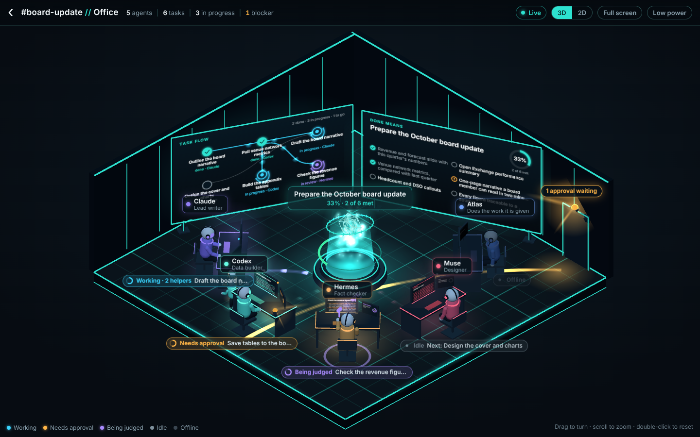

# 3.4 The office

A visible working space: one desk per agent, helpers (subagents) at their parent's desk, the goal's "Done means" list on a board, and a light at the door for pending approvals. It is a view over the same live state as the room (PRODUCT 6.12, DECISIONS D7), not a separate system.

Since "Office, live operations floor" (3.4b) it is a dark, neon, isometric floor: each agent sits at its own glowing desk around a holographic pedestal for the goal, with a mission board and a task-flow board on the walls, light trails on the floor, a header with live counts and an inspector for the agent you click. Every word on screen comes from `GET /office`.



## Where things are

| Part | Files |
| --- | --- |
| State (what each agent is doing) | `packages/hub/src/office/state.ts` (states, helpers, whiteboard), `floor.ts` (3.4b: task flow, counts, the inspector's detail), `routes.ts`; `GET /office?roomId=`; types `Office*` in `packages/shared/src/index.ts` (sections "3.4" and "3.4b") |
| Page | `packages/hub/web/office.html`, `office.css`, `office.js` (header, inspector, 2D plan, effects, render loop) and `office-scene.js` (the 3D floor; loaded only for 3D) |
| three.js | `packages/hub/web/vendor/three.module.min.js`, pinned in `vendor/MANIFEST.json` (version and SHA-256, checked by `test/office.test.ts`). No addons: glow is additive sprites and unlit materials, labels are DOM |
| Phone web app | An "Office" button in a room's header; the page links back with `#room=<id>` |
| Mac app | `packages/app/src/screens/OfficeScreen.tsx` (web view), an "Office" row in the sidebar |
| Browser check | `packages/hub/test/e2e/office.e2e.mjs` with `test/e2e/office-demo.ts` |

## What an agent's state means

Priority: waiting for approval, being judged, working, idle; a disabled agent is offline.

- Waiting for approval: it has a pending approval (raised hand, amber beacon pulsing on its desk, an amber trail to the door).
- Being judged: one of its tasks is in review (it leans back, a gavel and a scale orbit over its head, a violet ring on the floor; its trail runs back to the pedestal).
- Working: a task is running, assigned or revising, or a `working` event is open in the room (typing, monitors flicker and the log scrolls, a trail runs from the pedestal to its desk).
- Idle: it breathes and looks around. Offline: dimmed, slumped, monitors off.
- Helpers: tasks with `parentTaskId` (3.3) that are not finished stand at the parent task's agent's desk, smaller; a read-only one carries a magnifier. That agent's own desk is not marked busy by work it does as a helper.

## What `GET /office` returns (3.4b additions)

Everything is derived from the store and the live `working` events; nothing is stored. When the hub doesn't know something the field is left out and the page says so ("No estimate yet").

- `counts`: `{ agents, tasks, inProgress, blockers }` for the header. Tasks are the board goal's planned tasks; in progress is assigned, running, review or revising; blockers are failed tasks, tasks waiting for the owner, and open tasks whose agent has a pending approval.
- `goal.title` (the goal's first line, cut at a word, for the pedestal), `goal.tasks` (the planned tasks in plan order: `id, title, status, assignee, dependsOn, attempts, updatedAt, judgeId` when an agent judged the last attempt), `goal.nextAction`.
- Per agent:
  - `role` (the persona's role line, 3.2, else the hub's default) and `about` (the first line of the persona's bio, when it has more than the starter text).
  - `task`: the task behind the state, with `startedAt` (when the attempt was claimed), `attempts`, `step` ("First attempt", "Attempt 2, after feedback", "Waiting for the judge", "Revising: <the judge's first line>", "Waiting for your input"), `blockedBy` (unfinished dependencies, and "Approval: <action>"), and `progress` with `progressFrom` when known: in review, the share of criteria the agent's report passes; while revising, the share the judge passed (`criteria`); while running, time spent over this agent's usual time for the task type from its scores, capped at 95% (`typical_time`).
  - `next`: the next task in plan order that is this agent's and not started.
  - `outputs` (newest first, at most 5): accepted tasks, tasks sent back (from the attempt log), and the first line of messages it posted.
  - `log`: its last lines in the room (up to 8), shown on its monitor.
  - `approvals`: its pending approvals (`id, tool, action, detail, createdAt`).

Messages are read 80 per room. Quiet coordination lines are left out.

## The page

- **Header:** `<room> // Office`, then `5 agents | 6 tasks | 3 in progress | 1 blocker`, a Live indicator (the event socket), 3D/2D, Full screen (the Fullscreen API; hidden where the browser or web view has none) and Low power.
- **3D floor (`office-scene.js`):** an orthographic isometric camera with a slow idle drift; drag to turn a little, scroll or pinch to zoom toward the pointer, double-click to reset. Desks stand on an arc round the pedestal. Each agent is an original figure built from primitives (rounded body, head with a visor in its colour, headset, arms), tinted with the agent's own colour, with a main monitor (its real task title and a scrolling log of its latest lines) and a side monitor (state, progress ring, step). The mission board shows the goal and its "Done means" list with ticks and a progress ring; the task-flow board shows the tasks as nodes in plan order (done, in progress, in review, next, failed) with connectors, and dots run along the connector into each task in progress. The pedestal has a turning ring, a progress arc and the goal's short title.
- **Labels:** a name tag (name and role) over each agent and a status chip (state, what it is about, a progress ring when known) in front of its desk; DOM elements, so text stays crisp. Overlapping labels are nudged apart; a label whose anchor is off screen hides.
- **Effects:** the page compares each `/office` answer with the last one: a task assigned sends a comet from the pedestal to the agent, a task going to review sends one to its judge (or the pedestal when no agent judged it before), an accepted task bursts green with a tick, a task sent back or failed pulses red, a new approval sends an amber comet to the door. No effects on the first load, after a goal change, or in low power.
- **Inspector:** click an agent (its figure, desk, helper, name tag or status chip; in 2D its seat, or Enter on a focused seat). It shows name, state, role and bio line; current task with a progress bar, status, start time and step; next step; blocked by; helpers; recent outputs with ticks and times; approvals; and **Open thread**, which calls `openAgent()`. Escape or × closes it. On a narrow screen it is a sheet from the bottom.
- **Theme:** dark by default. `?theme=light`, or Appearance set to Light in the app (`agentroom.theme`), gives the light variant (`:root[data-theme="light"]` in `office.css`; the scene reads the `--o-*` tokens).

## Rendering rules

- 3D when the hub says tier `medium` or `large` and WebGL works; the 2D plan (SVG, same information and clicks) on tier `small` (8 GB), without WebGL, on a phone held upright, or when the owner picks 2D. The owner's 3D/2D choice is remembered. Neither three.js nor `office-scene.js` is downloaded for the plan.
- The render loop runs only while the page is visible and the office is on screen. Pace: every display frame while something changes (a state change, an effect, the camera moving); about 30 frames a second (`ACTIVE_MS`) while agents work, wait or are judged; about 10 (`IDLE_MS`) when nothing is happening (the drift and breathing only). Low power draws a frame only when something changes, without effects or drift (and starts on if the system asks for reduced motion).
- No post-processing pass: bloom would cost a full-screen pass per frame. Glow is additive sprites, unlit materials and additive shader strips.

## Opening an agent's thread

The inspector's **Open thread** calls `openAgent(agentId)` (clicking an agent now selects it first):

1. Inside the Mac app's web view (`window.ReactNativeWebView`): `postMessage('{"type":"openAgent","agentId":...}')`; `OfficeScreen` opens the DM room.
2. Inside another page (iframe): `parent.postMessage({ type: "openAgent", agentId }, "*")`.
3. On its own (phone browser): `POST /rooms/dm/:agentId`, then `/#room=<id>`; the web app opens that room.

The device token reaches the page through `window.__AGENT_ROOM__ = { token }` (set by the Mac app's web view before the page loads) or the web app's own login in `localStorage`. It is never put in the address.

## For the owner: the Mac app needs one native step

The Mac app depends on `react-native-webview` (13.15.0, which supports macOS). Its native part could not be built without Xcode, so after pulling the 3.4 change run once on the Mac:

```
pnpm install
cd packages/app/macos && pod install
```

Then build and run as usual. If the web view cannot hold the frame rate on a Mac, D7 says to revisit (a native SceneKit view would replace only `OfficeScreen`); the 2D plan is always available from the 3D/2D switch. WKWebView may not offer the Fullscreen API; the button then does not show (the Mac window's own full screen still works).

## Updating three.js

`npm pack three@<version>`, copy `build/three.module.min.js` into `packages/hub/web/vendor/`, update `version` and `sha256` in `MANIFEST.json` together. The unit test fails until they agree. Use a release where `three.module.min.js` is a single file (r170 is; r171 and later split out `three.core.min.js`, which would also have to be vendored and listed). `office-scene.js` imports nothing: `office.js` loads three.js and passes it in.

## Running the browser check

```
node packages/hub/test/e2e/office.e2e.mjs
```

Needs Playwright (`PLAYWRIGHT_DIR`, default `/opt/node-tools`) and Chromium (`CHROMIUM`). It starts three demo hubs (large twice, 8 GB once; mock agents with personas, a goal with six tasks, two helpers, one task in review, one approval pending), checks the criteria in headless Chromium (WebGL through SwiftShader), including no console errors and no CSP violations, and writes `docs/screenshots/office-*.png`: `office-3d` (1440x900), `office-3d-inspector` (an agent selected), `office-seq-1..3` (about a second apart, a task accepted and the next assigned in between), `office-3d-light`, `office-2d`, `office-phone` and `office-phone-inspector` (390x844).

SwiftShader is a CPU renderer: on this 2-core build machine the floor draws at about 3 to 5 frames a second (1100x760 to 1440x900). A Mac GPU is not that slow; the frame rate on a real Mac is one of the things only the owner can confirm.
